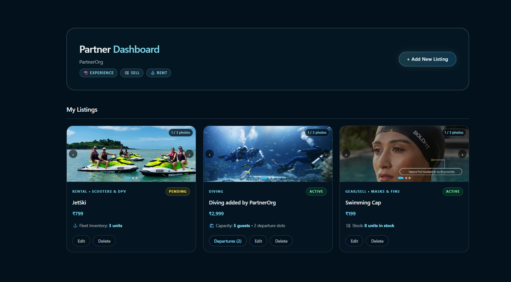
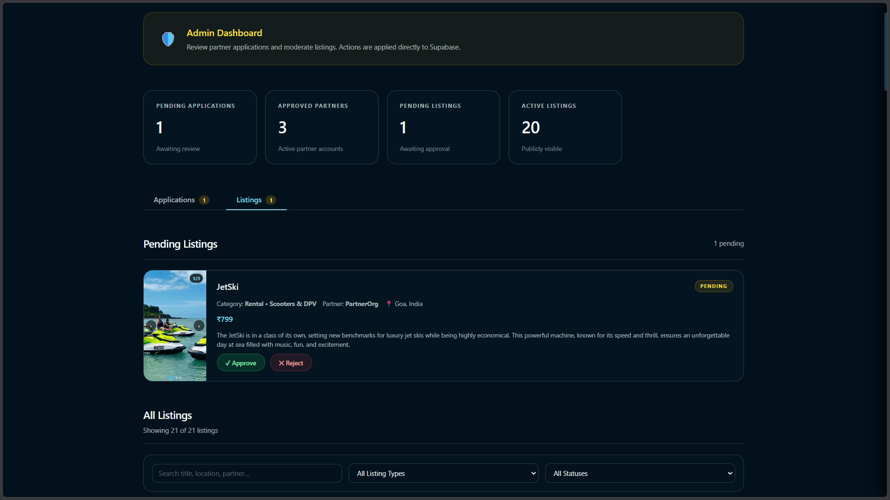
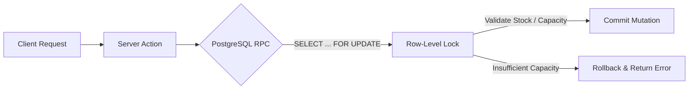

<div align="center">

# 🌊 Project BLUE

**A cinematic ocean-exploration scrollytelling platform and full-stack marine marketplace.**

Immerse yourself in a 7-stage photorealistic descent from low Earth orbit to the benthic abyss, paired with a multi-role commercial marketplace for guided marine expeditions, technical scuba gear, and equipment rentals.

Built with Next.js, React 19, TypeScript, Supabase (PostgreSQL with Row Level Security), and bespoke Vanilla CSS.

[](https://blue-next-livid.vercel.app/)


[Features](#-features) · [Tech Stack](#-tech-stack) · [Try Project BLUE](#-try-project-blue) · [Developer Setup](#-developer-setup) · [Architecture & Scrollytelling Engine](#-architecture--scrollytelling-engine) · [Database & Integrity](#-database-design--integrity) · [Troubleshooting](#-troubleshooting)

</div>

------------------------------------------------------------------------

## 📽️ Demo

<p align="center">
  
</p>

*A seamless 24fps scroll-driven descent across seven oceanic depth zones, transitioning into live charter reservations, fleet rentals, and retail checkout.*

------------------------------------------------------------------------

## 🖼️ Screenshots

| Scrollytelling — 7-Stage Orbital to Abyss Descent (`/`) | Deep-Ocean Experiences Marketplace (`/explore`) |
|:-------------------------------------------------------:|:-----------------------------------------------:|
|  |  |

| Equipment Rentals & Date Selection (`/rentals/[id]`) | Unified Customer Bookings Portal (`/bookings`) |
|:----------------------------------------------------:|:----------------------------------------------:|
|  |  |

| Partner Dashboard — Fleet & Session Control (`/partner/dashboard`) | Admin Governance & Moderation Queue (`/admin`) |
|:-----------------------------------------------------------------:|:----------------------------------------------:|
|  |  |

------------------------------------------------------------------------

## ✨ Features

| Feature | Description |
|---|---|
| **Dual-Video Scrolly Engine** | Custom RAF seek synchronizer rendering 24fps intra-iframe encoded video transitions across 7 oceanic depth zones with velocity-based bidirectional fast-forwarding and canvas gradient lighting. |
| **Expedition Marketplace** | Full marine discovery index with category and difficulty filters (*Night Dives*, *Open Water*, *Wreck Exploration*), real-time session capacity inspection, and passenger reservations. |
| **Fleet Equipment Rentals** | Date-interval rental calculator with dynamic duration math, automatic refundable security deposits, and concurrent fleet availability validation. |
| **Technical Diving Gear Store** | Retail dive equipment catalog with stock quantity tracking, brand specifications, and a persistent cart backed by server-side price re-validation. |
| **Multi-Tenant Partner Hub** | Dedicated operator portal for verified dive charters: listing CRUD, Supabase Storage multi-image uploader, departure session scheduler, and rental fleet inventory manager. |
| **Admin Moderation & Governance** | Role-gated administration console to review partner applications, inspect listing submissions (`draft` $\rightarrow$ `pending` $\rightarrow$ `active`/`rejected`), and toggle live listing visibility. |
| **Hardened Customer Accounts** | Supabase Auth SSR cookie synchronization via edge request proxy, profile management, active reservation cancellation, and anti-enumeration 8-digit email OTP recovery. |

> **Security & Transactional Integrity:** All mutations execute through **Next.js Server Actions** (`"use server"`) backed by PostgreSQL stored procedures (`PL/pgSQL`). Concurrency is protected via `SELECT ... FOR UPDATE` row-level locks on departure sessions and rental fleet units to eliminate overselling and race conditions. Completed customer order and booking trails are protected by `ON DELETE RESTRICT` schemas against partner or listing deletion.  
> *Note on Checkout:* Order creation, server pricing calculation, and atomic inventory reduction are fully implemented; payment processing is connected to a simulated gateway for portfolio evaluation.

------------------------------------------------------------------------

## 🛠️ Tech Stack

| Layer | Technology | Key Capabilities & Architecture Role |
|---|---|---|
| **Frontend Framework** | **Next.js 16.4.3** | App Router, React Server Components (RSC), and Server Actions (`"use server"`) for mutation pipelines. |
| **UI Library** | **React 19.3.0** | Concurrent rendering, optimistic transitions, context-driven cart state, and custom hook synchronizers. |
| **Type System** | **TypeScript 5.x** | Strict end-to-end type safety covering database schemas, RPC payload contracts, and component props. |
| **Scrolly Engine** | **Dual `<video>` + RAF** | Bespoke 24fps seek synchronizer across dual buffers (`#videoA` & `#videoB`) with bidirectional fast-forwarding. |
| **Graphics & Audio** | **Canvas 2D + Web Audio** | Dynamic ambient gradient sampling, responsive letterboxing, and spatial audio ducking cross-fades. |
| **Styling Architecture** | **Vanilla CSS & Glassmorphism** | Zero-runtime CSS custom properties, backdrop blur filters, fluid typography, and hardware-accelerated transforms. |
| **Database & RPCs** | **Supabase (PostgreSQL)** | Relational integrity, `ON DELETE RESTRICT` schemas, and atomic stored procedures with `SELECT ... FOR UPDATE` locks. |
| **Auth & Edge Security** | **Supabase Auth SSR** | Edge request proxy (`proxy.ts`), cookie-based session hydration, multi-role RBAC (`admin`/`partner`/`customer`), and 8-digit OTP. |
| **Object Storage** | **Supabase Storage** | Public `listing-images` bucket for partner media staging, multi-file uploads, and secure asset hosting. |
| **Testing Suite** | **Vitest 3.x** | 49 automated unit tests validating rental duration math, pricing calculations, and security sanitization. |
| **Hosting & Platform** | **Vercel** | Global edge network, automated Turbopack builds, serverless function isolation, and edge cookie proxying. |

------------------------------------------------------------------------

## 🌐 Try Project BLUE

Experience the live application deployed on Vercel:

<div align="center">

### 👉 [https://blue-next-livid.vercel.app/](https://blue-next-livid.vercel.app/)

</div>

### Suggested Walkthrough

1. **Ocean Scrollytelling (`/`):**
   * **Desktop:** Scroll down and up using your mouse wheel. Notice the smooth 24fps video frame seeking, seamless loop cross-fading, spatial audio ducking, and how scrolling up fast-forwards loop videos for quick traversal.
   * **Navigation:** Click on the numbered dots (`01`–`07`) in the right-side journey navigation bar to jump directly between marine zones. Click the `BL U E.` logo in the header anytime to smoothly reset to the surface.
   * **Mobile:** Touch-swipe vertically to scrub through passages and hold to inspect underwater scenes.
2. **Marine Expeditions (`/explore`):**
   * Filter expeditions by category and certification level. Open an expedition (e.g., *Advanced Reef Diving Expedition*) to inspect the itinerary, departure schedule, and live seat capacity drawer.
3. **Equipment Rentals & Cart (`/rentals` & `/gear`):**
   * Configure rental date intervals on high-performance gear. Notice automatic daily rate and security deposit calculations. Add retail gear to your cart and test the server-validated checkout flow.
4. **Partner & Admin Portals (`/partner/dashboard` & `/admin`):**
   * Apply for operator verification at `/partner/apply` or log in as an administrator to inspect the listing review queue and partner application audits.

------------------------------------------------------------------------

## 🧑‍💻 Developer Setup

This section is for developers who want to clone the repository, run the application locally, or contribute.

### Prerequisites

| Tool | Required? | Notes |
|---|---|---|
| **Node.js** | Yes | Version `v20.x` or `v22.x` (LTS recommended) |
| **npm** | Yes | Included with Node.js (`v10.x+`) |
| **Supabase Instance** | Yes | Hosted project at [supabase.com](https://supabase.com) or local Supabase CLI |
| **Git** | Yes | To clone and manage version control |
| **Modern Browser** | Yes | Chrome, Edge, Safari, or Firefox with HTML5 H.264 video decode support |

### 1. Clone the repository

```bash
git clone https://github.com/frieden300/blue-next.git
cd blue-next
```

### 2. Install dependencies

```bash
npm install
```

### 3. Configure environment variables

Create a `.env.local` file in the root folder based on the included template:

```bash
cp .env.example .env.local
```

Open `.env.local` and add your Supabase project credentials:

```ini
# Supabase Configuration (Client & Server)
NEXT_PUBLIC_SUPABASE_URL="https://your-project-id.supabase.co"
NEXT_PUBLIC_SUPABASE_PUBLISHABLE_KEY="your-supabase-publishable-key"
```

### 4. Database setup & migrations

The database schema, stored procedures, and Row Level Security policies are maintained as 9 sequential SQL migrations in `supabase/migrations/`:

```
supabase/migrations/
├── 001_initial_schema.sql                      # Profiles, roles, listings, images, RLS
├── 002_user_roles_read_policy.sql              # Role query policy permissions
├── 003_orders_and_bookings.sql                 # Orders, order_items, rental & experience bookings
├── 004_partner_listing_workflow.sql            # Draft -> Pending -> Active/Rejected lifecycle
├── 005_fix_rls_infinite_recursion.sql          # is_admin() security definer function
├── 006_drop_insecure_password_reset_rpc.sql    # Security hardening for Supabase Auth OTP
├── 007_booking_concurrency_and_inventory.sql   # Atomic book_rental, book_experience & create_order RPCs
├── 008_listing_identity_and_foreign_keys.sql   # ON DELETE RESTRICT historical record protection
└── 009_experience_session_capacity_and_booking # Seat capacity enforcement in book_experience RPC
```

Apply these migrations to your Supabase project using the Supabase CLI (`supabase db push`) or by executing the SQL files in order within the Supabase SQL Editor.

Ensure a public storage bucket named `listing-images` is created in your Supabase project for partner listing image uploads.

### 5. Run the application

```bash
# Start local development server (Turbopack enabled)
npm run dev

# Run automated Vitest test suite (49 tests passing)
npm test

# Build optimized production bundle
npm run build

# Start production server
npm start
```

Open [http://localhost:3000](http://localhost:3000) in your browser.

------------------------------------------------------------------------

## 🏗️ Architecture & Scrollytelling Engine

Project BLUE separates presentation, stateful media synchronization, and transactional persistence with strict boundaries.

<p align="center">
  <a href="docs/architecture/detailed_system_architecture.png" target="_blank">
    
  </a>
  <br>
  <em>💡 Tip: Click the image above to view it in full resolution.</em>
</p>

### Codebase Overview

| Area | Location | Responsibility |
|---|---|---|
| **App Router & Pages** | `src/app/` | Server-rendered pages (`/`, `/explore`, `/gear`, `/rentals`, `/bookings`, `/partner`, `/admin`) and Server Actions (`actions.ts`). |
| **Auth Callback Handler** | `src/app/auth/callback/route.ts` | The only Route Handler in the project; handles Supabase Auth OTP verification and code exchange. |
| **Edge Request Proxy** | `src/proxy.ts` | Edge session refresh handler and cookie forwarder protecting authenticated `/admin` and `/partner` routes. |
| **Scrollytelling Engine** | `public/assets/scrollytelling.js` | Dual-buffer `<video>` orchestrator, RAF velocity tracker, canvas lighting, and audio ducking manager. |
| **Scrolly Component** | `src/components/scrolly/` | React wrapper, brand header overlay, journey depth navigation dots, and interactive CTA card. |
| **Marketplace Components** | `src/components/marketplace/` | Experience/Rental booking drawers, image gallery, difficulty filter pills, and product cards. |
| **Partner Portal Client** | `src/components/partner/` | Comprehensive operational client: listing forms, image upload stager, session scheduler, and rental fleet controls. |
| **Admin Console Client** | `src/components/admin/` | Moderation queue: partner application review, listing approval/rejection notes, and lifecycle toggles. |
| **Cart State** | `src/components/cart/` | Client React Context with `localStorage` (`blue_cart_v1`) persistence and reactive nav counters. |
| **Supabase SSR Clients** | `src/lib/supabase/` | Cookie-based Supabase client initializers for Server Components, Server Actions, and Browser Clients. |
| **Authorization Utils** | `src/lib/auth/roles.ts` | Server-side role validation helpers (`isPartner`, `isAdmin`) verified directly against PostgreSQL roles. |
| **Unit Test Suite** | `src/lib/utils/__tests__/` | 49 automated Vitest unit tests covering date math, pricing computations, input validation, and media URL sanitization. |

### Video & Audio Scrollytelling Pipeline

The scrollytelling engine synchronizes dual `<video>` buffers (`#videoA` and `#videoB`) with continuous requestAnimationFrame seeking. All video assets were preprocessed using custom Python/OpenCV optical flow scripts and encoded with **intra-iframe only** compression (`-g 1 -keyint_min 1 -bf 0`) to enable instantaneous, frame-accurate seeking at 24fps without decoding lag:

| Stage | Name | Mode | Video Asset | Audio Sync Track | Atmosphere & Depth |
|:---:|---|:---:|---|---|---|
| **01** | **BLUE PLANET** | Loop | `V1Lrus_s36.mp4` | Ambient Hydrophone | Low Earth orbit looking down at the blue planet. |
| **02** | **LAND IN SIGHT** | Passage | `V2Pds_s36cV3Pds.mp4` | Ambient Hydrophone | Atmospheric descent toward distant island and coastal waters. |
| **03** | **BLUE HORIZON** | Loop | `V4Lds.mp4` | `V4LA.mp3` | Ocean surface swell and offshore blue water. |
| **04** | **THE DESCENT** | Passage + Loop | `V5.00Pds.mp4` / `V5.14Lds.mp4` | `V5and8LA.mp3` | Surface break into sunlit subsurface water. |
| **05** | **DIVE BOAT** | Loop | `V6Lds_s27.mp4` | `V6LA.mp3` | Mid-ocean dive boat expedition and prep. |
| **06** | **CORAL DESCENT** | Passage | `V7Pds.mp4` | Ambient Hydrophone | Descent toward vibrant shallow and mid-depth coral reefs. |
| **07** | **BLUE ABYSS** | Loop | `V8Lds_b.mp4` | `V5and8LA.mp3` | Deep ocean drop-off and benthic marine expanse. |

------------------------------------------------------------------------

## 🔐 Database Design & Integrity

The backend is built on **Supabase PostgreSQL** with Row Level Security (RLS) enabled across all public tables:



* **Zero-Overselling Concurrency Protections:** Stored procedures `book_experience` and `book_rental` lock target departure sessions and rental fleet rows using `SELECT ... FOR UPDATE`, guaranteeing serial execution during concurrent customer reservations.
* **Trusted Server Pricing:** `processCheckoutAction` ignores client-submitted prices from `localStorage`. The server verifies listing IDs against live database records, calculates line totals and taxes server-side, and submits verified amounts to the atomic order RPC.
* **Immutable Historical Records:** Foreign keys linking `listings` to `order_items`, `rental_bookings`, and `experience_bookings` enforce `ON DELETE RESTRICT`. Partners can archive offerings, but completed customer purchases and booking history remain permanently immutable.
* **RLS Recursion Guard:** PostgreSQL function `is_admin()` runs with `SECURITY DEFINER` and `SET search_path = public`, eliminating circular policy evaluations when inspecting `user_roles`.

------------------------------------------------------------------------

## 🛠️ Troubleshooting

### Scrollytelling video is black or shows loading indicator
* Ensure the video assets are present in [`public/assets/master/`](file:///c:/Users/viraj/Projects/blue-next/public/assets/master).
* Confirm your browser supports MP4 H.264 playback and that hardware acceleration is enabled.

### Database or booking RPC errors
* Ensure all 9 migrations from `supabase/migrations/` were applied in numerical order.
* Confirm that PostgreSQL stored procedures (`book_experience`, `book_rental`, `create_order`, `get_experience_sessions_availability`) exist under the `public` schema.

### Partner or Admin dashboard redirects to login
* Access to `/admin` requires a record in `user_roles` with `role = 'admin'`.
* Access to `/partner/dashboard` requires an approved application and a record in `user_roles` with `role = 'partner'`.
* Verify that your browser permits third-party session cookies if accessing a remote Supabase instance across different domains.

### Vitest unit tests failing
Run the test suite directly to check output:
```bash
npm test
```
All 49 unit tests in `src/lib/utils/__tests__/` should pass cleanly.

------------------------------------------------------------------------

## 🤝 Contributing

Contributions, bug reports, and suggestions are welcome.

1. Fork the repository.
2. Create a feature branch (`git checkout -b feature/amazing-feature`).
3. Commit your changes (`git commit -m "feat: add amazing feature"`).
4. Push to the branch (`git push origin feature/amazing-feature`) and open a Pull Request.

Please do not commit uncompressed raw video files, `.env` files, or production credentials to the repository.

------------------------------------------------------------------------

## 📄 License

This project is licensed under the MIT License — see the [`LICENSE`](file:///c:/Users/viraj/Projects/blue-next/LICENSE) file for details.

------------------------------------------------------------------------

<div align="center">

Built with ❤️ by **Viraj** · [GitHub](https://github.com/frieden300)

*Project BLUE — Where the horizon is only the beginning.*

</div>
